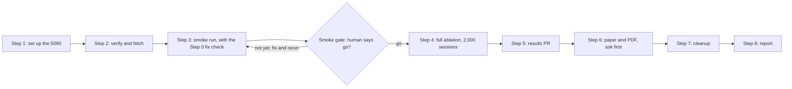

# AI_Project completion plan (RTX 5090 run)

24 Nov 2026 · Mayank Sharma

## The project

**Intelligible Blackboard Architecture with Counterfactual Agents** ([repository](https://github.com/Naitik-Gupta96/AI_Project), default branch `main`). Three language-model agents coordinate through a shared blackboard using the PXP protocol (INIT / RATIFY / REVISE / REFUTE / REJECT). When the board deadlocks, counterfactual-capable agents replay the session in a sandbox and apply the best alternative to the live board. The code is finished and tested. What is left is to run the experiments with Qwen2.5-7B-Instruct (the spec asks for a local 7B model), check them, put the results into the repository and the paper, and clean up.

## How to use this doc

This is the one instruction set for finishing AI_Project. Give it to Claude Code on the RTX 5090 machine: it runs Steps 0 to 8 in order, and waits for the human at the stop points listed below.



Steps 1 to 3 set up the machine and prove it on a smoke run; nothing after the gate starts without the human's go.

**Giving it to the machine.** This plan is `PLAN_RTX_5090.md` at the root of `main`, the project's one instruction file. Download it outside the repository, then tell Claude Code: *Read ~/ai_project_plan.md and carry it out.*

```bash
curl -fsSL https://raw.githubusercontent.com/Naitik-Gupta96/AI_Project/main/PLAN_RTX_5090.md -o ~/ai_project_plan.md
```

Work from that copy, not the file in the repository: the fix branch in Step 0 is older than this plan, so checking it out removes the file from the working tree. If the plan changes, the file is updated through a PR.

**When the work is done, delete this plan.** Step 7 removes `PLAN_RTX_5090.md` from `main` with the cleanup PR, and the last act of Step 8 deletes `~/ai_project_plan.md`.

**What it replaces.** It combines and supersedes `COMPUTE_PROMPT.md`, which was removed from `main` when this file was added, and `rtx_5090.md`, a hand-off that was never committed. Do not look for either file.

**Read first, in the repository:** `README.md`, `docs/experiments.md`, `scripts/gpu_runbook.md`, `docs/architecture.md`.

**Stop points.** Stop, report in the chat, and wait for an explicit answer when:

1. The GPU is not NVIDIA, or has less than 12 GB of memory (Step 1).
2. `refsol.py` cannot be downloaded (Step 2).
3. The MedAgentBench fix does not help, or breaks something (Step 3).
4. **The smoke gate:** the smoke run is done. Report its numbers, its deadlock rate and the runtime estimate, then wait for a go before the full run (Step 3).
5. Anything would change the experimental design (Rules).
6. Before drafting any paper section the team owns (Step 6).

**Keep a log** outside the repository (`~/ai_project_run_log.md`): start and end times, commands, PR links, numbers, problems. Step 8's report is built from it.

## Rules

These hold for every step.

- **Git identity.** Commit as Mayank Sharma, using the same email as Mayank's existing commits on `main`. Set it per repository:

  ```bash
  git config user.name "Mayank Sharma"
  git config user.email "$(git log -1 --format=%ae --author=mayank-sharma262006 origin/main)"
  git config user.email   # must print an address, not an empty line
  ```

  Log in with `gh auth login` as `mayank-sharma262006` (push access, not admin). Add no `Co-Authored-By` or other attribution lines to commits or PRs.

- **Workflow.** Never commit to `main`. Use a short branch (`fix/...`, `exp/...`, `docs/...`, `chore/...`), open a PR, and wait for CI to pass: ruff, pytest on Python 3.11 and 3.13, web tests and build. Then squash-merge with the PR number in the subject and delete the branch: `gh pr merge <n> --squash --delete-branch`. After each merge, run `git switch main && git pull && git fetch --prune`.

- **Style.** Commits use short conventional subjects (`feat:`, `fix:`, `docs:`, `exp:`, `chore:`) with a plain body that says why. PR descriptions are a few factual lines. No emoji, no marketing tone. Match `git log` and the existing docs.

- **Never commit data.** Keep out of git: `data/`, `runs/`, `.cache/`, model weights, `refsol.py`, session logs, `cache.sqlite`, `docker-compose.override.yml`, your copy of this plan and your log.

- **Do not change the experimental design.** Leave alone: group fractions, sample sizes, seeds, session settings (message budget, k, τ, interventions, apply mode, tool calls) and scoring thresholds, including MSCoRe's 0.3 ROUGE-L. If something forces a change, stop and ask.

- **What you may fix.** Bugs in adapters, parsing, tools or the UI, each with a test, in its own PR. Change prompt wording only if a smoke run shows the model misreading an instruction. The one agreed change to what agents see is the MedAgentBench fix in Step 0.

- **One machine, one path, one build.** All four groups come from this machine, vLLM, `Qwen/Qwen2.5-7B-Instruct` in bf16, one vLLM image and one commit of `main`. Never use Ollama, and never mix in the Mac results.

- **Report honestly.** Copy numbers from `summary.json`; never estimate or round them up. Say what failed or was skipped.

## Where the project stands (24 Nov 2026)

The code for all four spec deliverables is finished, and `main` (`65c178c`) is green. What remains is the real-model ablation, its results, the team's paper sections, and cleanup.

**Done.** On `main`, 353 tests pass and ruff is clean. A setup, verification and smoke run on an Apple M5 Mac (Ollama, 4-bit) found the bugs below; all are fixed with tests, and none of the Mac's numbers are results.

| PR | Fix |
| --- | --- |
| #8 | The MSCoRe file `Automotive Value Chain/Easy/Supply Chain` on Hugging Face has no closing `]`. The loader now reads it. Do not re-download or repair the file. |
| #9 | Replies must carry boolean judgments; `explanation_agrees: null` made sessions fail at temperature 0. |
| #10 | The `fhir_get` and MedAgentBench answer examples were task1_1's real question and answer, and the model copied them. They are placeholders now. |
| #12 | `refsol.py` is loaded with the harness's `utils` (`send_get_request`, `verify_fhir_server`). Checked against the real grader for task types 1-4, 6, 9 and 10. |
| #13 | The paper's Experimental setup and the full reference author lists are written. |
| #14 | A trial that runs again starts a fresh `sessions/<trial>/events.jsonl`. |
| #15 | `fhir_get` quotes paths as `requests` does in the original harness, so a name with a space no longer errors. |

**Mac smoke run, for reference only** (20 trials, `bb check` OK, no grader errors, largest prompt 3,712 tokens):

| Group | Benchmark | Convergence | Deadlocks | Messages | Tokens/instance |
| --- | --- | --- | --- | --- | --- |
| cf0 | KramaBench | 0.33 | 0 | 4.0 | 10,982 |
| cf0 | MedAgentBench | 0.00 | 0 | 4.0 | 12,221 |
| cf0 | MSCoRe | 0.00 (ROUGE-L 0.10) | 0 | 4.0 | 3,630 |
| cf100 | KramaBench | 0.33 | 0 | 4.0 | 10,982 |
| cf100 | MedAgentBench | 0.00 | 0 | 4.0 | 11,782 |
| cf100 | MSCoRe | 0.00 (ROUGE-L 0.10) | 0 | 4.0 | 3,630 |

Every session reached consensus in 4 messages (INIT, then RATIFY from the others). Nothing deadlocked, so no counterfactual intervention ever ran, and the two groups came out almost identical. That is the main risk to the paper, and the reason for the smoke gate in Step 3.

**Decisions already taken (do not reopen):**

- Path A: vLLM with `Qwen/Qwen2.5-7B-Instruct` in bf16, using `experiments/configs/smoke.toml` and `ablation.toml` exactly as they are.
- MSCoRe runs as designed. Expect accuracy near 0% in every group: the team writes 50 to 250 characters, while references have a median of about 1,100. Report it plainly in the Results, with the ROUGE-L values, and say why.
- Commits go out as Mayank Sharma (Rules).
- **The full run goes ahead even if the 5090 smoke run shows no deadlocks** (decided 24 Nov 2026). The Results then report the null result plainly; the design is not changed to force deadlocks.

**Left to do:** Steps 0 to 8 below.

## Step 0: pick up the MedAgentBench fix

MedAgentBench scored 0 of 6 in the Mac smoke run. The likely cause: agents never saw MedAgentBench's POST functions (their URLs and payload fields), which the original harness lists for its agent, so the order and record tasks could not be answered in a gradable form. A fix exists on branch `fix/medagentbench-post-functions`; it is pushed (commit 38b92a5, 354 tests pass) but not yet proven on a real model.

**What it changes:** `src/ai_project/benchmarks/medagentbench.py` adds `MedAgentBenchmark.answer_format()`. That method appends every `POST` function from `funcs_v1.json` to the answer format, each with its full URL (`<FHIR base><Resource>`, no double slash, as the grader compares it), its description and its payload fields. `tests/benchmarks/test_loaders.py` gains `test_medagentbench_answer_format_lists_the_post_functions`. With it, 354 tests pass.

1. After cloning (Step 2), fetch the branch:

   ```bash
   git fetch origin && git branch -r | grep fix/medagentbench-post-functions
   ```

   If it is not there, stop and ask the human to push it from the Mac.

2. Check it out, run `python -m pytest` and `ruff check src tests scripts`, then switch back to `main`.

3. Do not open its PR yet. Step 3 tests it on the real model first, and the full run must not start until it is merged or dropped.

## Step 1: check the hardware and start the services

An RTX 5090 (32 GB, Blackwell sm_120) runs Path A: vLLM with bf16 weights, at the compose defaults. Confirm it before installing anything. The services start from the repository's compose file, so do Step 2's clone (item 1) before item 4 here.

1. Detect the hardware: run `nvidia-smi --query-gpu=name,driver_version,memory.total --format=csv`, then `uname -sm` (Linux) or `systeminfo` (Windows).

   | Found | Do |
   | --- | --- |
   | NVIDIA, 16 GB or more | Path A, bf16 (expected) |
   | NVIDIA, 12 to 15 GB | Stop and ask. The fallback is the AWQ build, a different model build, so only with the human's yes: `MODEL=Qwen/Qwen2.5-7B-Instruct-AWQ docker compose up -d vllm` (if it runs out of memory, lower `--max-model-len` in `docker-compose.yml` to 12288), with copies of `smoke.toml` and `ablation.toml` that use `Qwen/Qwen2.5-7B-Instruct-AWQ` as provider and judge and have new run names. |
   | Anything else | Stop and report the hardware |

2. **Driver and OS.** Blackwell needs NVIDIA driver 570 or newer, with CUDA 12.8 builds.

   - **Linux:** Docker Engine plus `nvidia-container-toolkit`. Run the long jobs in `tmux`.
   - **Windows:** Docker Desktop with the WSL2 backend. Work only inside the WSL2 Ubuntu shell, with the repository in the Linux home directory, never under `/mnt/c` (530 MB of KramaBench lakes are slow through `/mnt/c`). Set the power plan to never sleep.
   - Also needed: Python 3.11+, Node 20+, git, `gh`.

3. **Docker sees the GPU:** `docker run --rm --gpus all nvidia/cuda:12.8.0-base-ubuntu22.04 nvidia-smi`.

4. **Pull vLLM once.** Run `docker compose pull vllm` now, and never again until the full run is finished: one image means one model build. An old cached image fails with "no kernel image is available for execution on the device".

5. **Start the services and keep them up.** FHIR is an x86 image and runs natively here.

   ```bash
   docker compose up -d vllm fhir
   docker update --restart unless-stopped $(docker compose ps -q vllm fhir)
   docker compose build sandbox
   curl -s http://127.0.0.1:8000/v1/models          # repeat until Qwen/Qwen2.5-7B-Instruct is listed (~15 GB first download)
   curl -s http://127.0.0.1:8080/fhir/metadata | head -c 300
   docker run --rm ai-project-sandbox python -c "import pandas; print('sandbox ok')"
   ```

   On the Mac, the FHIR container was once stopped without warning. While FHIR is down, MedAgentBench sessions get tool errors and the grader cannot read reference values, so check it before every run.

6. **If vLLM fails at startup for lack of memory** (the display also uses VRAM), set `--gpu-memory-utilization 0.85` in an untracked `docker-compose.override.yml`. It is a server setting, not the design; never commit it.

7. **Record the build** in the log; it goes into the Results:

   ```bash
   docker image inspect vllm/vllm-openai:latest --format '{{index .RepoDigests 0}}'
   docker compose exec vllm python3 -c "import vllm; print(vllm.__version__)"
   nvidia-smi --query-gpu=name,driver_version,memory.total --format=csv
   ```

The model is not gated, so no Hugging Face token is needed.

## Step 2: verify the code and get the data

The tree must pass every check before any model runs. If anything fails, fix it through a PR (Rules) first.

1. **Clone and install** (on Windows, inside WSL2, in `~`):

   ```bash
   git clone https://github.com/Naitik-Gupta96/AI_Project.git && cd AI_Project
   python3 -m venv .venv && source .venv/bin/activate
   pip install -e ".[dev,bench,plots]"
   ```

   Then set the git identity (Rules) and run `gh auth login`.

2. **Verify:**

   ```bash
   python -m pytest                                   # 353 pass on main
   ruff check src tests scripts
   (cd web && npm ci && npm test && npm run build)
   bb run --cf analyst                                # mock session; ends "status CONSENSUS answer Option B"
   ```

   `bb run --cf analyst` also shows a counterfactual intervention with the mock model; it is the fallback evidence that the mechanism works.

3. **Step 0** now: fetch and test the MedAgentBench fix branch.

4. **Data:**

   ```bash
   bb fetch mscore kramabench medagentbench          # ~450 MB MSCoRe + ~530 MB KramaBench lakes
   curl -L -o data/medagentbench/refsol.py \
     "https://stanfordmedicine.app.box.com/index.php?rm=box_download_shared_file&shared_name=fizv0unyjgkb1r3a83rfn5p3dc673uho&file_id=f_1756907296228"
   wc -c data/medagentbench/refsol.py               # 15541 bytes
   head -2 data/medagentbench/refsol.py             # "import json", "from .utils import *"
   ```

   That URL is the direct download behind the Box link in the [MedAgentBench README](https://github.com/stanfordmlgroup/MedAgentBench). If the size or first lines differ (for example, an HTML login page), stop and ask the human to download it from the README link. Never commit `refsol.py`.

## Step 3: smoke run, MedAgentBench check and the gate

The full run starts only after the smoke run is healthy on the final commit of `main`, the MedAgentBench fix is merged or dropped, and the human has said go.

1. **Baseline smoke run on `main`:**

   ```bash
   git switch main && git pull
   time bb ablate experiments/configs/smoke.toml      # writes runs/experiments/smoke-qwen2.5-7b
   bb check runs/experiments/smoke-qwen2.5-7b         # must print OK
   ```

   `bb check` fails (exit code 1) on crashed trials, more than 5% failed sessions, grader errors or missing token counts. It warns on judge fallbacks to ROUGE-1 and on more than one rejected attempt per session. Fix real bugs through PRs, then rerun with `--restart` (allowed for smoke runs only).

2. **Test the MedAgentBench fix.** Six smoke trials are too few to show a difference, so compare 20 MedAgentBench tasks with and without the fix. This check config lives outside the repository and is not part of the design:

   ```bash
   cat > ~/medcheck.toml <<'EOF'
   name = "medcheck-main"
   provider = "vllm:Qwen/Qwen2.5-7B-Instruct"
   seed = 0
   workers = 8
   max_in_flight = 16
   cache = true

   [groups]
   fractions = [0.0]

   [[benchmarks]]
   name = "medagentbench"
   n = 20

   [session]
   max_messages = 12
   reject_after = 3
   tau = 0.75
   max_interventions = 2
   apply = "both"
   max_tool_calls = 4
   EOF
   bb ablate ~/medcheck.toml                          # on main
   git switch fix/medagentbench-post-functions
   sed 's/medcheck-main/medcheck-fix/' ~/medcheck.toml > ~/medcheck-fix.toml
   bb ablate ~/medcheck-fix.toml
   ```

   Before running, confirm that the session settings above match `smoke.toml`, and copy any that differ. Then compare accuracy and `score_mean` in the two `summary.json` files. In `trials.jsonl`, open a few `score.detail` entries: posts should use the listed URLs (`<base>Observation`, `<base>MedicationRequest`, `<base>ServiceRequest`), and the grader should raise no errors.

   - **Better, and nothing else broken:** open the PR from that branch, titled `fix: list the MedAgentBench POST functions in the answer format`. The body says why (the original harness shows its agent these functions) and gives both runs' numbers, copied from `summary.json`. Wait for CI, then squash-merge.
   - **Not better:** stop and ask the human whether to merge it anyway (it matches the original harness) or drop it.

3. **Final smoke run on the merged `main`.** The MedAgentBench prompt changed, so run again: `git switch main && git pull`, then `time bb ablate experiments/configs/smoke.toml --restart` and `bb check` (must print OK). Write down `git rev-parse HEAD`; the full run uses this commit.

4. **Read real sessions.** Run `bb serve --runs runs/experiments/smoke-qwen2.5-7b --experiments runs/experiments` and open http://127.0.0.1:8765. Without a browser, read `sessions/<trial>/events.jsonl` and `trials.jsonl` directly, and ask the human to look at the UI. Read at least two sessions per benchmark:

   - **MSCoRe:** answers in Chinese and on topic; plausible match / agree / changed judgments.
   - **KramaBench:** `list_files` and `python` tool events in the board log; the final answer in the format the question asks for.
   - **MedAgentBench:** predictions are JSON `{"answer": [...], "posts": [...]}`, graded without errors.
   - **Counterfactual:** any deadlocked 100%-group session shows an intervention with sandbox branches. Then start one live session from the UI's **New session** form with the vLLM provider, to confirm streaming works.

5. **STOP: the smoke gate.** Report to the human, then wait for an explicit go:

   - the final smoke numbers per group and benchmark, copied from `summary.json`;
   - **the deadlock rate and the number of interventions in the 100% group.** If both are 0 again, say plainly that the four groups will probably not differ. The team has already decided to run the full ablation anyway, so this alone does not block the go;
   - the MedAgentBench before / after numbers and the PR link;
   - **the runtime estimate:** final smoke elapsed time ÷ 20 trials × 2,000. It is a ceiling: the full run has 24 workers instead of 8, and the cache shares calls between groups. Flag it if it is over 48 hours.

## Step 4: the full ablation

The full run is 4 groups (0, 33, 67 and 100% counterfactual-capable agents) × 500 tasks (300 MSCoRe + 100 KramaBench + 100 MedAgentBench) = 2,000 sessions, from `experiments/configs/ablation.toml` unchanged, into `runs/experiments/ablation-qwen2.5-7b`. Start it only after the human's go at the smoke gate.

1. **Before starting:**

   - `git rev-parse HEAD` equals the commit you recorded in Step 3, and `git status` is clean.
   - `docker compose ps` shows vLLM and FHIR up, and `curl` answers on both ports.
   - There is enough disk: about 100 × `du -sh runs/experiments/smoke-qwen2.5-7b`.

2. **Run it detached, kept awake,** and log the start time:

   - **Linux:**

     ```bash
     tmux new -s ablation
     source .venv/bin/activate
     systemd-inhibit --what=sleep:idle bb ablate experiments/configs/ablation.toml 2>&1 | tee -a ~/ablation.log
     ```

   - **Windows (WSL2):** the same inside `tmux` in the WSL2 shell, without `systemd-inhibit`. The power plan must already be set to never sleep.

3. **Freeze the setup until it finishes.** No `docker compose pull`, no driver or OS updates, no `git pull`, no code changes in this checkout.

4. **If it stops** (crash, reboot, a service going down), bring the services back and run the same command again. Finished trials are kept, and only missing ones run. Never pass `--restart` unless the human asks.

5. **Every few hours,** run `bb check runs/experiments/ablation-qwen2.5-7b` and log the progress line.

   - Grader errors usually mean FHIR is down: stop the run (Ctrl-C), restart FHIR, and resume with the same command.
   - A code bug mid-run is a stop point. A fix would put two commits into one run, so report it and ask the human.

6. **Find a counterfactual example.** After a few hundred trials, look in the 100% group for a deadlocked session with an applied intervention, and note its trial id for the Results. If the finished run has none, say so.

7. When it finishes, log the end time and the total runtime, then run `bb check` once more.

## Step 5: report the results and open the results PR

One PR, `exp/ablation-qwen2.5-7b`, carries the results, the figures, the docs' Results section, the paper's Results text and the README status. Every number is copied from `summary.json`.

1. **Generate:**

   ```bash
   R=runs/experiments/ablation-qwen2.5-7b
   bb check $R | tee $R/health.txt          # must end with OK
   bb report $R                             # figures/, tables/, summary.json, groups.csv
   ```

2. **Add the files** on branch `exp/ablation-qwen2.5-7b`:

   - `results/ablation-qwen2.5-7b/` (repository root): `meta.json`, `summary.json`, `groups.csv`, `health.txt`, `figures/`, `tables/`, and `trials.jsonl.gz` (`gzip -k trials.jsonl`). Leave out the `.gz` if it is over 50 MB, and say so.
   - `paper/figures/` and `paper/tables/`: copies of the run's `figures/` and `tables/`. `paper/main.tex` already includes `tables/groups.tex`, `figures/convergence.png`, `intelligibility.png` and `tokens.png`.

3. **`docs/experiments.md`:** add a `## Results` section before `## Limitations`. Keep "served by vLLM" in Design.

   - Setup facts: the model and build (bf16, the vLLM version and image digest), GPU and driver, the commit of `main`, run dates and total runtime.
   - The per-group table: convergence success with 95% Wilson intervals, and McNemar p-values against the control group, overall and per benchmark.
   - One short paragraph each on convergence success, intelligibility depth (Ultra-Strong / Strong share) and token cost (live vs sandbox), saying only what the numbers show. Include deadlock and recovery rates.
   - MSCoRe: accuracy at the 0.3 threshold near 0% in every group, with the ROUGE-L F1 values and why (50 to 250 characters against references of about 1,100).
   - The counterfactual example trial from Step 4, or the statement that none occurred.

4. **`paper/main.tex`:**

   - Replace the comment `% Serving stack, model build, hardware and run dates: added with the results.` with one sentence of those facts.
   - Write the Results text around the existing table and figures, in the style of the Experimental setup.
   - Do not touch the Introduction, Architecture or Discussion (Step 6).

5. **`README.md`:** replace the Status section with the run name, the headline numbers and a link to `results/ablation-qwen2.5-7b/`. In `docs/team.md`, set Milestone 4's state to done, with a link to the results.

6. **Commit and merge:** run `ruff` and `pytest` (in case docs tests exist), commit `exp: add the ablation-qwen2.5-7b results`, open the PR, wait for CI and squash-merge.

7. **Hand over the large artifacts** (never committed): the session logs the UI replays, and the cache that makes reruns free.

   ```bash
   cd runs/experiments && zip -r ~/ablation-qwen2.5-7b-artifacts.zip ablation-qwen2.5-7b/sessions ablation-qwen2.5-7b/cache.sqlite
   ls -lh ~/ablation-qwen2.5-7b-artifacts.zip
   ```

   The zip stays on the 5090 machine only (decided 24 Nov 2026): do not upload or copy it elsewhere. Report its path and size.

## Step 6: the team's paper sections and the PDF

Three sections of `paper/main.tex` are still one-line `%` comments, and they belong to the team. Ask the human before writing any of them.

| Section | Now | Material to draw on |
| --- | --- | --- |
| Introduction | `% Motivation: chains vs a shared structured state; PXP; deadlocks; counterfactual credit.` | `README.md`, `docs/pxp.md`, `docs/counterfactual.md` |
| Architecture | `% Four layers (docs/architecture.md): ...` | `docs/architecture.md` |
| Discussion and limitations | `% See docs/experiments.md#limitations.` | the results; `docs/experiments.md` Limitations and caveats |

1. **Ask** whether to draft these sections or leave them to the team.

   - **If asked to draft:** use branch `docs/paper-sections`. Use only the repository's docs and the results, and cite only entries in `paper/references.bib`. Open the PR for the team to review, and merge it only when the human says the team approved.
   - **The author line** (`Team (see docs/team.md)`): proposed as Naitik Gupta, Malay Neema, Mayank Sharma, Yash Singh (alphabetical by surname), on branch docs/paper-authors. If it is not on main yet, ask the human whether the team confirmed it. Never change the names or order on your own.
   - **The abstract:** offer to add one sentence with the headline numbers.

2. **Build the PDF** after the results PR (Step 5):

   ```bash
   sudo apt install -y latexmk texlive-latex-extra    # Linux / WSL2; or upload paper/ to Overleaf
   cd paper && latexmk -pdf main.tex
   ```

   Check that no "Missing ... run bb report" boxes remain and that the citations resolve. Do not commit the PDF or LaTeX build files unless the human asks. Tell the human where the PDF is.

## Step 7: clean up

Do this last, after every other PR is merged. The goal: `main` is the only branch, `git status` is clean, and this plan is gone from the repository.

1. On branch `chore/cleanup`, remove this plan:

   ```bash
   git rm PLAN_RTX_5090.md
   git ls-files COMPUTE_PROMPT.md rtx_5090.md               # must print nothing; git rm anything it prints
   git grep -n -E "COMPUTE_PROMPT|PLAN_RTX_5090|rtx_5090"   # must print nothing
   git ls-files | grep -E "^(\.claude|data|runs|\.cache)/|refsol\.py|\.sqlite$"   # must print nothing; git rm --cached anything listed
   ```

2. Commit `chore: remove the RTX 5090 run plan`, open a PR with a one-line description, wait for CI, squash-merge and delete the branch.

3. Leave the repository tidy:

   - `git ls-remote --heads origin` lists only `main`; locally, delete every merged branch (`git branch -d`).
   - Delete the check configs (`~/medcheck.toml`, `~/medcheck-fix.toml`) and the `runs/experiments/medcheck-*` directories. Keep the smoke and ablation runs and the artifacts zip.
   - Remove `docker-compose.override.yml` if you created one, once the services are no longer needed.
   - `git status` is clean. Keep your log outside the repository.

4. Leave vLLM and FHIR as they are, and ask the human in the report whether to stop them.

## Step 8: report to the human

The final report goes in the chat, not the repository, and every number in it comes from `summary.json` or `bb check`. Cover:

- **Setup:** GPU, driver, OS, vLLM version and image digest, the model build (bf16), the commit of `main` that ran, start and end times, total runtime.

- **Problems:** everything fixed, with PR links, and anything left unfixed.

- **Run health:** the final `bb check` output.

- **Results,** overall and per benchmark, for each group:

  - convergence success with 95% CI;
  - deadlock and recovery rates;
  - Ultra-Strong / Strong share;
  - tokens per instance, live vs sandbox;
  - McNemar results against the control group.

- **The counterfactual example:** its trial id, or that none occurred.

- **Locations:** `results/ablation-qwen2.5-7b/` on `main`, the artifacts zip path and size, and the PDF.

- **Cleanup:** `PLAN_RTX_5090.md` removed, the checks printed nothing, only `main` remains.

- **Still open:** for example the team's paper sections, the author line, and whether to stop the services.

**Progress** (tick as each lands):

- [ ] Step 1: hardware confirmed, services up, build recorded
- [ ] Step 2: tests, ruff, web and mock session pass; data and `refsol.py` in place
- [ ] Step 3: MedAgentBench fix merged or dropped; final smoke OK; human said go
- [ ] Step 4: 2,000 trials finished; `bb check` OK
- [ ] Step 5: results PR merged; artifacts zipped
- [ ] Step 6: team sections decided; PDF built
- [ ] Step 7: cleanup PR merged; only `main` left
- [ ] Step 8: report sent
- [ ] Plan deleted: `PLAN_RTX_5090.md` from `main` and `~/ai_project_plan.md`

**Last: delete this plan.** Once the report is sent, run `rm ~/ai_project_plan.md`. Step 7 has already removed `PLAN_RTX_5090.md` from `main`. Keep your log: it is the record of the run.

## Caveats and open questions

**Known caveats.** These are already documented in `docs/experiments.md`; repeat them in the Results where they apply.

- **MSCoRe answers are capped** at about 500 characters, so prompts fit the context window. ROUGE-L is therefore lower than for unconstrained answers, equally in every group.
- **The KramaBench paraphrase judge** for the 10 `string_approximate` tasks is the same Qwen model. KramaBench itself used a stronger judge; say so.
- **The model makes its own judgments** of explanation agreement and reasoning change. Code then applies the tag rule exactly.
- **The intervals are wide:** KramaBench and MedAgentBench have 100 tasks each.
- `refsol.py` prints lines such as `task2_13 [81] [...]` while grading. That is expected.

**Open questions for the human**, before or during the run:

- [ ] Who runs the 5090, on which OS, and starting when? What is the submission deadline?
- [ ] Paper authors: proposed Naitik Gupta, Malay Neema, Mayank Sharma, Yash Singh (alphabetical by surname). The team to confirm the order.
